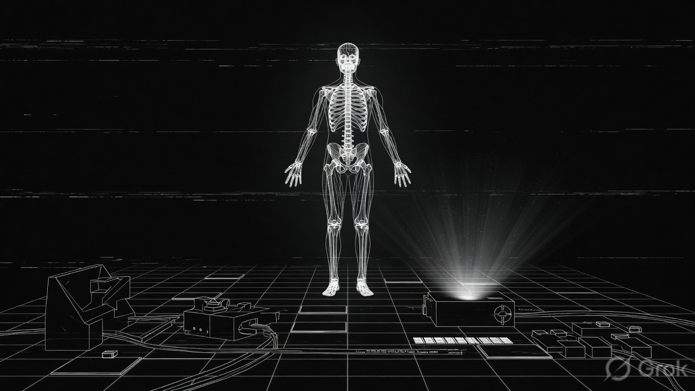

# AETHERIS

**A black-and-white research terminal you can fly through — from the whole body down to the nanoscale.**

[](https://github.com/kxz0tn/aetheris)
[](LICENSE)
[](https://kxz0tn.github.io/aetheris/)

<p align="center">
  
</p>

---

Aetheris is a **browser-based research station**. You move freely in a single 3D space and descend through biological scale — body, tissue, cells, molecules, then the nano/field layer — without loading screens. It is not a game with levels or scores. It is a classified-looking terminal for exploration, measurement, and tightly constrained intervention.

Open it in any modern desktop browser. No install.

**[Launch Aetheris →](https://kxz0tn.github.io/aetheris/)**

---

## What is Aetheris?

Imagine standing in a dark laboratory. In the center is a holographic human figure. You fly around it. Then you go *in* — not by changing menus, but by changing **scale**. The figure stays where it is. The world around you densifies. Muscle, vessels, cells, protein complexes, and nano-scale fields appear in place.

Everything you see is drawn by code: white and gray lines on a black void. No downloaded 3D models, no stock textures, no licensed fonts, no audio packs. The look is a military research console: sharp, monochrome, precise.

At the deepest scale you can use a **Nano-Assembler**. It is not a magic builder. It has an energy budget, local material, heat limits, and a scale gate. Writes can ripple upward (a cascade) and then relax. That is the point: understand coupled systems, not rack up points.

> **v0.0 (Beta) — in development.** The facility is real enough to explore. It is not finished.

---

## Features

- **One continuous space** — no level loads between body and nano
- **Free 6DOF flight** — fly, look, and orbit the holographic twin
- **Scale continuum** — Macro → Tissue → Cellular → Molecular → Nano / Field
- **Research instruments** — Scanner (observe), Probe (measure), Assembler (constrained write)
- **Cross-scale cascade** — a nano write can show up at cell and molecule scale, then fade
- **Operative terminal HUD** — scale, tools, integrity, and a short scientific log
- **Strict monochrome** — black void, white/gray geometry, system monospace type
- **Zero copyrighted assets** — procedural geometry only; MIT-licensed code

---

## Live Demo

**Use it now, no setup:**

### [https://kxz0tn.github.io/aetheris/](https://kxz0tn.github.io/aetheris/)

Works best on a desktop or laptop with a mouse. A mid-to-high desktop should run smoothly.

---

## How to Run Locally

You only need this if you want the source on your machine.

```bash
git clone https://github.com/kxz0tn/aetheris.git
cd aetheris
npm install
npm run dev
```

Then open the URL Vite prints (usually `http://127.0.0.1:5173/`).

On Windows PowerShell, if `npm` is blocked, use `npm.cmd` instead.

**Production build:**

```bash
npm run build
npm run preview
```

The static site is written to `dist/`.

---

## Operator Manual

You do not need to be a scientist or a programmer. Follow this once and you will understand the station.

### 1. Enter the station

Open the [live demo](https://kxz0tn.github.io/aetheris/). You should see a black space, a holographic body, and a terminal panel in the top-left.

**Click the 3D view once** to lock the mouse (look around). Press **Esc** to unlock.

### 2. Move

| Control | What it does |
|---|---|
| **W A S D** | Fly forward / left / back / right |
| **Space** | Up |
| **Ctrl** | Down |
| **Mouse** | Look (after click-to-lock) |
| **Shift** | Speed boost |
| **Right mouse drag** | Orbit around the body |

There is no ground. You are flying in a research volume.

### 3. Change scale

Scale is how “deep” you are looking — not a zoom menu. The world densifies around you.

| Control | What it does |
|---|---|
| **Mouse wheel** | Descend / ascend continuously |
| **[ or − or Page Down** | Descend |
| **] or = or Page Up** | Ascend |
| **1** | Macro (whole body) |
| **2** | Tissue |
| **3** | Cellular |
| **4** | Molecular |
| **5** | Nano / Field |
| **0** | Reset to Macro |

**Tip:** After you press **3**, **4**, or **5**, fly *into* the body — a thigh, a vessel, a cell — so the detail has room to be read.

### 4. Instruments

Press **T** to cycle tools:

`STANDBY → SCANNER → PROBE → ASSEMBLER → STANDBY`

| Tool | Purpose | Extra controls |
|---|---|---|
| **Scanner** | Reveals one scientific channel at a time. Does not change the world. | **Q** — cycle channel: Structure, Vascular, Cellular, Fields, Molecular, Nano/Field |
| **Probe** | Measures a point in space (load, vessels, cells, molecules, nano). | **E** or **left click** (mouse locked) — take a sample |
| **Assembler** | Limited writes at **Nano** scale only. Costs energy, material, and heat. | **Q** — cycle action: Reinforce / Bind / Field. **E** or **left click** — execute |

**F** toggles tissue field overlays (diffusion / mechanical). Independent of the Scanner.

The Assembler will refuse work if you are not deep enough, if energy is low, if there is no local material, or if the site is too hot. That is intentional. Read `STAT` on the terminal.

### 5. How to read the terminal (HUD)

Top-left. Black panel, white type.

| Block | Meaning |
|---|---|
| **NAV** | Where you are: scale number, band name (MACRO, TISSUE…), position, speed |
| **SYS** | Station health: QUIET / COUPLING / STRESSED / THERMAL, plus cascade lines |
| **INS** | Active tool. Scanner channel, Probe readings, or Assembler budget (E / SUB / THRM / GATE) |
| **LOG** | Last actions: `ASM` success, `REJ` reject, `CPL` cascade. Oldest lines fall off |

`CPL` means a change at one scale is still affecting another. It will fade.

### 6. Recommended first session (about five minutes)

1. Open the live demo. Click the view. Orbit the holographic body with right-mouse drag.
2. Press **2**. Fly along a limb. Notice vessels and tissue structure appearing.
3. Press **3**. Fly into mid-thigh. Find a cluster of cells. Press **T** to **PROBE**, then **E**.
4. Press **4**, then **5**. Fly into a small cage around a complex.
5. Press **T** to **ASSEMBLER**. If `GATE` is OPEN, press **E** once (Reinforce).
6. Watch **LOG** and **SYS**. Press **3** and Probe the same region. You may see a brief stress / occupancy change. Then it relaxes.

If something is refused, read `STAT`. Descend further, pick a closer target, or wait for heat to drop.

---

## Current Status

**v0.0 (Beta) — in development.**

This is an early public build of a research-style exploration platform. You can fly the full scale stack, use the three instruments, and see constrained nano writes cascade and decay.

It is **not** a finished product. Expect rough edges, ongoing science, and new station wings. It is **not** a traditional game: there are no scores, timers, or win conditions.

---

## Tech Stack

- [Three.js](https://threejs.org/) — 3D engine (MIT)
- [Vite](https://vite.dev/) — build and dev server (MIT)
- [TypeScript](https://www.typescriptlang.org/) — typed source (Apache-2.0, build-time only)
- Custom systems: scale continuum, procedural biology layers, instruments, cascade, terminal HUD

Runs entirely in the browser. No backend.

---

## License & Copyright

- **Aetheris** is released under the [MIT License](LICENSE).
- Runtime third party: **three.js** (MIT). See [THIRD_PARTY_LICENSES.md](THIRD_PARTY_LICENSES.md).
- All visible geometry is generated in code. No stock models, textures, audio, or webfonts.
- System monospace fonts only (`Courier New`, Courier, monospace).

You may use, copy, modify, and ship Aetheris under MIT, including commercially, with the license notice intact.

---

## Credits

**Aetheris** — original project by [kxz0tn](https://github.com/kxz0tn).

Built as a classified-style research station: exploration first, constraints real, spectacle refused.
